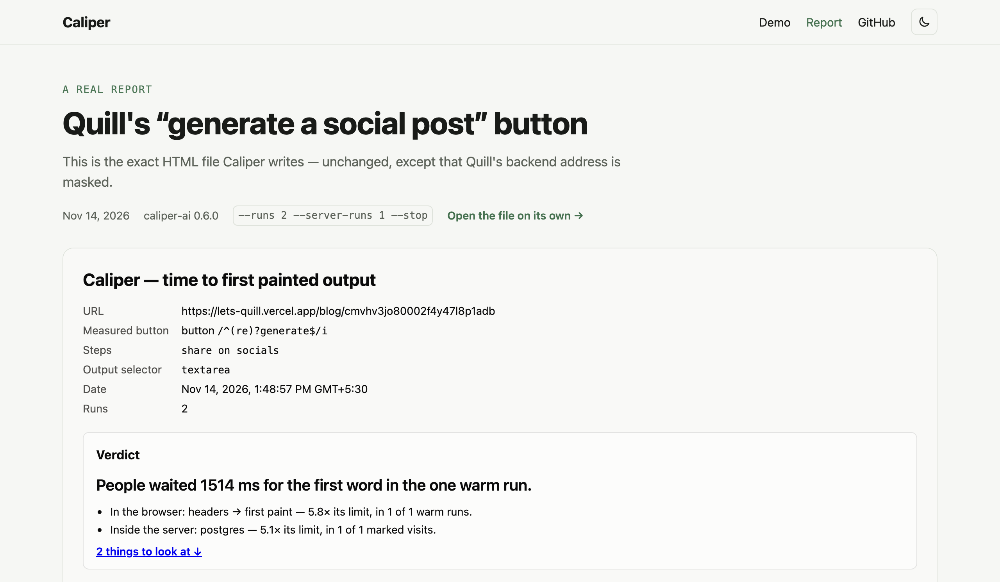

  

<h1 align="center">Caliper</h1>

See every step of the wait between a click and your AI feature's first word.

   
  
  
  
  

  Run against 
  
  
  
  
  
  

  <a href="https://caliper-audit.vercel.app/report">
    <picture>
      <source media="(prefers-color-scheme: dark)" srcset="https://raw.githubusercontent.com/Jia-A/caliper/main/.github/assets/report-dark.png">
      
    </picture>
  </a>

<a href="https://caliper-audit.vercel.app"><b>caliper-audit.vercel.app</b></a> · <a href="https://caliper-audit.vercel.app/report">the full report</a>

## Your AI reply feels slow. Is it the model?

Maybe. Caliper opens your AI feature in a real Chromium, clicks it like a user, and splits the wait from the click to the first word on screen into every step: in the browser, and, if you add its server half, inside your server. Each step is held against its own limit.

## One real report

| Where | Step | Time | Limit | Over by |
|---|---|---:|---:|---:|
| Browser, warm run | click → first word | **1514 ms** | – | – |
| Browser, warm run | response headers received | 926 ms | 600 ms | 1.5× |
| Browser, warm run | headers → first paint | 585 ms | 100 ms | **5.8×** |
| Server, one marked request | Postgres | 506 ms | 100 ms | **5.1×** |
| Server, one marked request | model call → first bytes sent | 540 ms | 450 ms | 1.2× |

Quill's "generate a social post" button, Nov 14, 2026, caliper-ai 0.6.0. The server rows come from one marked request, a separate request from the browser's warm run, on the server's clock, so they aren't parts of the 1514 ms.

Of the four steps over their limit, the model call was the least over. Inside the server, the step furthest over was the database, not the model.

## What you get

| Feature | What it tells you |
|---|---|
| **Timeline** | Every run from the click (or a chat send) to the first word, split into steps, with the one furthest over its limit named. |
| **Inside the server** | With caliper-timings in your app, one marked request reports the steps you mark (a database query, the model call) on your server's clock. |
| **Request Map** | The size of each part of the prompt and who wrote it. Sizes only: the prompt text is never recorded or shown. |
| **Advice** | Next steps that fire only from a number this run measured, and always quote that number and where its threshold comes from. |
| **Checks** | One flag each: whether Stop makes the browser abort the AI request, what a second click does to the first, whether a markdown image the model was told to write becomes a request (a data-leak path), and where your CSP lets images load from. |

## Two packages

| Package | What it is | Setup |
|---|---|---|
| [caliper-ai](packages/cli#readme) | The CLI. Times your AI feature in Chromium from the click to the first word, step by step, and writes an HTML report. | [packages/cli/README.md](packages/cli/README.md) |
| [caliper-timings](packages/timings#readme) | Optional, in your server. A request Caliper marks reports the steps you name and the size of each part of the prompt, never its text. Off unless you set your own `CALIPER_TOKEN`. | [packages/timings/README.md](packages/timings/README.md) |

## Limits

| Area | Limit |
|---|---|
| Browser | Chromium only, not Firefox or Safari. |
| Transport | HTTP only, not WebSockets. |
| What it sees | Timings, not your code: its hints are common causes, not a diagnosis. |

## How it was built

Jiya Agrawal designed Caliper and made every product decision: what to measure, the honesty rules (every number is measured; when Caliper can't tell, it says so), and what the report may claim. She tested it as a stranger on apps she didn't write, and those findings shaped 0.6.1. Claude Code wrote much of the implementation and the tests.

MIT licensed.
