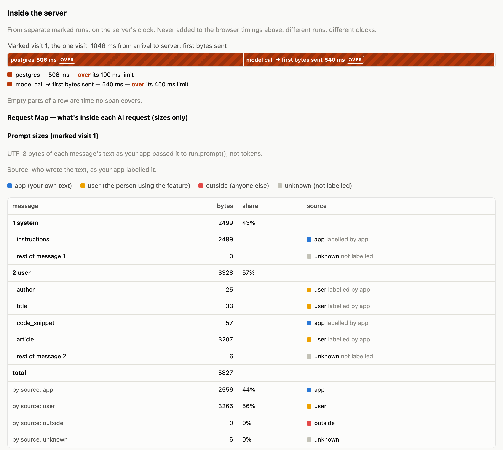

<p align="center">
  
</p>

<h1 align="center">caliper-timings</h1>

<p align="center">The server half of <a href="https://github.com/Jia-A/caliper">Caliper</a>: what happened inside one marked request.</p>

<p align="center">
  <a href="https://www.npmjs.com/package/caliper-timings"></a>
  
  
  
  
</p>

<p align="center">
  <a href="https://caliper-audit.vercel.app/report">
    <picture>
      <source media="(prefers-color-scheme: dark)" srcset="https://raw.githubusercontent.com/Jia-A/caliper/main/.github/assets/timings-dark.png">
      
    </picture>
  </a>
</p>

<p align="center"><a href="https://caliper-audit.vercel.app/report">The full report this is from</a> · <a href="https://caliper-audit.vercel.app">caliper-audit.vercel.app</a></p>

## The browser can't see inside your server

caliper-timings can. On a request Caliper marks, it times the steps you mark (a database query, the model call, the model's first chunk) on your server's clock, and measures each prompt part's size and who wrote it, never its text. Caliper reads the record back and shows it next to the browser's timings, never added to them.

It's off unless you set your own `CALIPER_TOKEN`, and requests Caliper didn't mark are never touched. No runtime dependencies: the core uses only `Date.now()`, Web Streams and `crypto.subtle`. The wire format is in [SPEC.md](SPEC.md), so other languages can implement it too.

## What it records, and what it never records

| Records | Never records |
|---|---|
| The ms of each mark you set, from when `start()` ran | The text of any message or prompt part |
| The response status | Request or response bodies |
| Each prompt message's role and size in UTF-8 bytes | A role that could be text: anything but a lowercase name is stored as `?` |
| Each named part's name, size, whether its text was found in its message, and its source (`app`, `user`, `outside`) | A part name that could be text (stored as `?`), or a source other than `app`, `user`, `outside` (dropped, with a problem naming the part by number) |
| Problems it hit (a bad mark name, an unreadable message), by number only | Anything for a request Caliper didn't mark |

## Run against

| Platform | How it was run |
|---|---|
| Node `node:http` | This README's Node sample, installed from the 0.6.1 tarball, in a stranger test (Nov 20, 2026). |
| Express | Google's example Gemini chat app's server, through the Node adapter (caliper-timings 0.6.0, Nov 19, 2026). |
| Next.js App Router | Vercel production: [caliper-audit](https://caliper-audit.vercel.app)'s `/api/chat` (then at caliper-demo.vercel.app), caliper-timings 0.6.0, Nov 14, 2026, where a marked visit's record came back. And locally with `next dev`: an AI SDK app (Next.js 16) and [examples/next-app-router](https://github.com/Jia-A/caliper/tree/main/examples/next-app-router) (Next.js 16.2.6). |
| Cloudflare Workers | Quill's backend (Hono, Workers AI), with the Workers adapter and its Durable Object store. |
| Vercel AI SDK, with `modelFirstChunk` | The AI SDK app with 0.6.1 (Nov 19, 2026): the model's first chunk at 3065 ms, where the first bytes sent were the SDK's envelope at 3 ms. |
| Gemini SDK `parts` | Measured since 0.6.1, tested with fixtures only. The live Gemini app hasn't run on 0.6.1 yet: its marked visit ran on 0.6.0, with messages mapped to `content` by hand. |

## How it was built

Jiya Agrawal designed Caliper and made every product decision: what to measure, the honesty rules (every number is measured; when Caliper can't tell, it says so), and what the report may claim. She tested it as a stranger on apps she didn't write, and those findings shaped 0.6.1. Claude Code wrote much of the implementation and the tests.

## Install

Two steps, in two places. Step 2 is optional.

### 1. On your machine: `caliper-ai`

The machine you run Caliper from (your laptop, or CI). It's the CLI that marks a request and reads the timings back:

```sh
npm install -g caliper-ai
npx playwright@1.64.1 install chromium
```

See the [caliper-ai README](https://github.com/Jia-A/caliper/tree/main/packages/cli#readme).

### 2. In your server's project: `caliper-timings` (optional)

Only if you want server timings. Install it in the project of the app Caliper measures, then wire it in as below:

```sh
npm install caliper-timings
```

Without it (or without `CALIPER_TOKEN` set on the server), Caliper still times everything it sees from the browser. Requires Node.js 20 or newer.

### 3. Set a token, in two places

Any non-empty string; it travels in an HTTP header, so letters and digits are safest. To make one:

```sh
openssl rand -hex 24
```

Put the **same** value in both places:

- **The server's environment**, as `CALIPER_TOKEN` (Next.js: `.env.local`, then restart `next dev`). Without it the wrapper is off, and Caliper's pre-check says `feature off (404 …)`.
- **The shell that runs `caliper audit`**: `export CALIPER_TOKEN=<the same value>`. Without it, `--server-timings` stops before any run and says so.

A different value in the two places gets `token rejected (401 …)` from the pre-check.

## Node (`node:http`)

```js
import { createServer } from "node:http";
import { createTimings, MemoryStore } from "caliper-timings/node";

const timings = createTimings({ token: process.env.CALIPER_TOKEN, store: new MemoryStore() });

createServer(async (req, res) => {
  if (await timings.handle(req, res)) return; // GET /__caliper/timings/:id; false for everything else

  if (req.method === "POST" && req.url === "/api/generate") {
    const run = await timings.start(req, res); // null unless this request is marked
    run?.mark("dbStart");
    const row = await db.query(/* … */);
    run?.mark("dbEnd");
    const messages = [{ role: "system", content: SYSTEM }, { role: "user", content: row.text }];
    run?.prompt(messages); // each message's role and size in bytes, never its text
    run?.mark("modelCallSent");
    res.writeHead(200, { "content-type": "text/event-stream" });
    for await (const chunk of model.stream(/* … */)) res.write(chunk); // the first write with bytes: firstChunk
    res.end();
    return;
  }
  // … your other routes and your 404
}).listen(8787);
```

- **`handle(req, res)`** answers `GET /__caliper/timings/:id` in SPEC.md's check order and returns `true`. For any other request it returns `false` and doesn't touch the response. With no token set it returns `false` for every request, so your own 404 answers.
- **`start(req, res)`** returns a `CaliperRun` only when the request carries a valid `x-caliper-run` and the right `x-caliper-token`. Otherwise it returns `null` and the request and response are left exactly as they were. Call it first thing in the route: marks are measured from the moment `start()` was called.
- **`run.mark(name)`** records ms since then. Name spans with `<name>Start` / `<name>End` (`dbStart` / `dbEnd`); Caliper shows each pair as a span called `<name>`. `modelCallSent`, `firstChunk` and `modelFirstChunk` are reserved. `modelFirstChunk` is the model's first chunk reaching your code: mark it from your SDK's per-chunk callback. Only its first call counts, and a record already saved (at `firstChunk`) is saved again with it, so the one line below is enough. See [AI SDK](#ai-sdk). A name outside `^[A-Za-z][A-Za-z0-9_]{0,63}$` is skipped, not thrown, and Caliper prints it under "problems reported by the server".
- **`run.prompt(messages)`** records each message's role and its size in bytes (UTF-8), in order, for Caliper's prompt sizes. Pass the same list you send to the model, just before the model call. With a separate system text (the AI SDK's `system:`, Anthropic's API), pass it as the first message. It never records the text. A message's size is its `content` string, or the sum of its text parts as SDKs send them: `content: [{ type: "text", text }]` (AI SDK model messages, OpenAI, Anthropic) or, with no `content`, `parts: [{ text }]` (Gemini). A part that isn't text (an image, a file, a tool call) makes that message's size `null`, never a partial sum, with a problem naming the message and part by number (and the part's type when it looks like one, e.g. `"image"`). A role that isn't a lowercase name (`system`, `user`, `assistant`, …) is recorded as `"?"`.

  ```js
  // AI SDK (v6, where convertToModelMessages is async): the model messages, system text first
  const modelMessages = await convertToModelMessages(messages);
  run?.prompt([{ role: "system", content: system }, ...modelMessages]);
  // Gemini SDK (@google/generative-ai): the history, then the new message
  run?.prompt([...history, { role: "user", parts: [{ text: msg }] }]);
  ```

  With tool calling, a later turn's history has tool calls and results, so those messages show `null`. It reads the list and never changes it. A later call replaces an earlier one. See [SPEC.md](SPEC.md#prompt-sizes).
- **`run.prompt(messages, { parts })`** also names pieces of a message: `parts` is a list of `{ message, name, text }`, where `message` is the index in `messages` (0 for the first), `name` follows the role rule (else `"?"`), and `text` is the exact string you put in that message, label included (`"Title: …"`). For each one it records the name, the text's size in bytes, and `found`: whether that text is inside the message. The text is used for that check and dropped, never recorded. Problems name a part by number only. A part naming no message, or one that can't be read, isn't recorded. At most 50 parts per message.
  ```js
  run?.prompt(messages, { parts: [{ message: 1, name: "title", text: titleLine }, { message: 1, name: "article", text: articleText }] });
  ```
- **`source` on a part** says who wrote its text: `"app"` (your own text), `"user"` (the person using the feature) or `"outside"` (anyone else). It's recorded as you give it; Caliper never fills it in, so a part without one shows as unknown. Any other value isn't recorded, with a problem naming the part by number. Needs caliper-timings 0.6.0: older versions ignore it without a problem.
  ```js
  { message: 0, name: "instructions", text: SYSTEM, source: "app" },
  { message: 1, name: "question", text: question, source: "user" },
  { message: 1, name: "search_results", text: results, source: "outside" },
  ```

#### Choosing a source

**Could anyone other than the person pressing the button have written this text? Then it's `"outside"`, even if it's in your own database.** It depends on the feature, not the field: a post's text is `"user"` when only its author can run the AI on it, and `"outside"` when readers can too. A part that mixes sources takes the least trusted one (`outside`, then `user`, then `app`); a label you put in front (`"Title: "`) doesn't make it `"app"`. Not sure? Leave it out: unknown is shown as unknown.
- **When the record is saved:** at the first `res.write` with bytes, with `firstChunk` marked then. Otherwise when the response closes, whether it finished or the client left. `status` is `res.statusCode`, or `null` if no headers were sent. Every write goes through unchanged.

### It never changes your app

A marked request succeeds or fails exactly as it would unmarked; that's the protocol's [rule](SPEC.md#the-rule-never-change-the-app). Nothing in the wrapper throws into your request:
- **`start()`** returns `null` if anything inside it fails, and the request runs unmarked.
- **`mark()` and `save()`** never throw or reject.
- **A store that throws or rejects** on save is logged to `console.error`, and the record is dropped.
- **A URL `handle()` can't parse** is left to your app.
- **A store failure while Caliper reads the timings endpoint** answers that request with 500.

### MemoryStore

`MemoryStore` keeps records in a `Map`, for 10 minutes after each write.

**Use it for single-process servers only.** On Workers, or several processes behind a load balancer, each one has its own `Map`, so Caliper's read can land where the write never happened (`404`).

**Cleanup:** every `put` deletes every expired record first, and a `get` that finds an expired record deletes it. After a write, the store holds only records written in the last 10 minutes. If writes stop, what's left stays until the next `put` or `get`. That's bounded by the last 10 minutes of marked requests, not a growing leak. Only requests carrying the right token create records.

## Fetch (`Request` / `Response`)

For runtimes and frameworks that hand you a Web `Request` and take a `Response` back. The token is passed on every call, because on Cloudflare Workers the secret is only available inside a request (`env`).

```js
import { finish, handle, MemoryStore, start } from "caliper-timings/fetch";

const store = new MemoryStore();

export default {
  async fetch(request, env, ctx) {
    const options = { token: env.CALIPER_TOKEN, store };
    const answered = await handle(request, options); // GET /__caliper/timings/:id; null for everything else
    if (answered) return answered;

    if (request.method === "POST" && new URL(request.url).pathname === "/api/generate") {
      const run = await start(request, { ...options, defer: (p) => ctx.waitUntil(p) }); // null unless marked
      run?.mark("modelCallSent");
      const stream = await model.stream(/* … */);
      const response = new Response(run ? run.watchFirstChunk(stream) : stream, { headers: { "content-type": "text/event-stream" } });
      return run ? finish(run, response) : response;
    }
    return new Response("not found", { status: 404 });
  },
};
```

- **`handle(request, { token, store })`** answers `GET /__caliper/timings/:id` in SPEC.md's check order, with the same JSON bodies and `cache-control: no-store` as the Node adapter. For any other request it returns `null`. With no token (unset or empty) it returns `null` for every request, so your own 404 answers.
- **`start(request, { token, store, defer })`** returns a `CaliperRun` only when the request carries a valid `x-caliper-run` and the right `x-caliper-token`. Otherwise it returns `null`, and the request runs unmarked. Marks are measured from this call. `defer` keeps a save alive after the response is returned (`ctx.waitUntil` on Workers); without it, the save still runs.
- **`finish(run, response)`** notes the response's status and returns the same `Response`. A stream passed through `run.watchFirstChunk(stream)` is saved at its first chunk with bytes, with `firstChunk` marked then; any other reply is saved by `finish`, without `firstChunk`.
- **Never throws.** `start()` returns `null` if anything inside it fails, `finish()` returns the response whatever happens, and a store failure on the endpoint answers 500.
- On Workers, `MemoryStore` lives in one isolate only, so Caliper's read can miss the record. Use a shared store there.

## Cloudflare Workers (Durable Object store)

`MemoryStore` doesn't work on Workers: each isolate has its own. `caliper-timings/workers` has a store that does, built on a Durable Object, and re-exports everything from `caliper-timings/fetch`.

```js
import { CaliperTimingsDO, DurableObjectStore, finish, handle, start } from "caliper-timings/workers";

export { CaliperTimingsDO }; // the class wrangler binds

export default {
  async fetch(request, env, ctx) {
    const options = { token: env.CALIPER_TOKEN, store: new DurableObjectStore(env.CALIPER_TIMINGS_DO) };
    const answered = await handle(request, options);
    if (answered) return answered;
    // … your routes: start(request, { ...options, defer: (p) => ctx.waitUntil(p) }), then finish(run, response)
  },
};
```

```jsonc
// wrangler.jsonc
"durable_objects": { "bindings": [{ "name": "CALIPER_TIMINGS_DO", "class_name": "CaliperTimingsDO" }] },
"migrations": [{ "tag": "v1", "new_classes": ["CaliperTimingsDO"] }]
```

- **One object per run id** (`idFromName(runId)`). It keeps the record as a JSON string under the key `"record"`, and an alarm deletes it 10 minutes after the last write. It answers `PUT` (204), `GET` (the record, or 404) and nothing else (405).
- **A write or read the object refuses** rejects in the store. `CaliperRun.save()` logs it and the record is dropped; the endpoint answers 500. Neither reaches the app's request.
- **No Cloudflare types needed.** The package declares the few methods it uses. Cloudflare's `DurableObjectNamespace`, `DurableObjectState` and `ExecutionContext` were checked to fit them, with TypeScript 5.9 and Wrangler's generated types.
- Moved from Quill's backend, with the same class name and storage format, so an app that had Quill's version keeps its binding and migrations.

## Serverless (Upstash Redis store)

On serverless hosts such as Vercel, each instance has its own memory, so `MemoryStore` can't hold a record for Caliper to read later. `caliper-timings/upstash` has a store on Upstash Redis, over its REST API with plain `fetch` (no dependency), and re-exports everything from `caliper-timings/fetch`.

```js
import { MemoryStore, UpstashStore } from "caliper-timings/upstash";

// UPSTASH_REDIS_REST_URL / _TOKEN, or the KV_REST_API_URL / _TOKEN names Vercel's integration sets.
const store = UpstashStore.fromEnv(process.env) ?? new MemoryStore();
```

- **One key per record,** `caliper:timings:<run id>`, written with `SET … EX 600`, so Redis deletes it 10 minutes after the last write, like the other stores.
- **`fromEnv(env)`** returns `null` when neither pair is complete, never throws. Pass the environment yourself (`process.env`, or Workers' `env`).
- **Use the Standard REST token,** not the Read Only one: the store writes.
- **Each call gives up after 2 s** (`timeoutMs` to change it). A refused, failed or timed-out call rejects with the command and the status or Upstash's error, never the token or the URL. `CaliperRun.save()` logs it and drops the record; the endpoint answers 500. Neither reaches your request.

## AI SDK

The AI SDK's `toUIMessageStreamResponse()` writes `{"type":"start"}` as soon as the stream opens, before the model answers. So `firstChunk` (server: first bytes sent) is that envelope, not the model. Mark the model's first chunk yourself, in `streamText`:

```js
const result = streamText({
  model,
  messages,
  onChunk: () => run?.mark("modelFirstChunk"), // the model's first chunk: only the first call counts
});
```

Caliper then shows "model call → model's first chunk". Without it, Caliper sees the AI SDK's `x-vercel-ai-ui-message-stream` header on the response and shows that span as `?` with this line as the fix, instead of the envelope's few ms. `onChunk` is the AI SDK's own callback: in `ai` 6.0.208 it's called for the model's content chunks (text and reasoning deltas, tool calls and their input, sources), not for lifecycle frames such as `start`, and with tool calling on every step. Only the first call counts. Tested with a stand-in for the AI SDK's stream (its header and envelope), not with the AI SDK itself: `npm test` here, and `npm run test:marked` in caliper-ai.

## Next.js App Router (and Vercel)

Route handlers take a Web `Request` and return a `Response`, so they use the fetch adapter as it is, with the Upstash store on Vercel. Both routes must use **one** store, so it lives in its own file:

```js
// lib/caliper.js
import { MemoryStore, UpstashStore } from "caliper-timings/upstash";

export const store = UpstashStore.fromEnv(process.env) ?? new MemoryStore();
```

```js
// app/api/generate/route.js: your own stream
import { after } from "next/server";
import { finish, start } from "caliper-timings/upstash";
import { store } from "../../../lib/caliper.js";

export async function POST(request) {
  const run = await start(request, { token: process.env.CALIPER_TOKEN, store, defer: (p) => after(() => p) });
  // … run?.mark(…), run?.prompt(messages, { parts }), then the model's stream:
  const stream = await model.stream(/* … */); // a ReadableStream
  const headers = { "content-type": "text/event-stream", "cache-control": "no-cache" };
  if (!run) return new Response(stream, { headers });
  return finish(run, new Response(run.watchFirstChunk(stream), { headers }));
}
```

With the AI SDK, the route already has a `Response` (`toUIMessageStreamResponse()`). Wrap its body and pass its status, status text and headers on, so a marked reply is the same as an unmarked one:

```js
// app/api/chat/route.js: AI SDK
import { after } from "next/server";
import { convertToModelMessages, streamText } from "ai";
import { finish, start } from "caliper-timings/upstash";
import { store } from "../../../lib/caliper.js";

export async function POST(request) {
  const run = await start(request, { token: process.env.CALIPER_TOKEN, store, defer: (p) => after(() => p) });
  const { messages } = await request.json();
  const modelMessages = await convertToModelMessages(messages);
  run?.prompt([{ role: "system", content: SYSTEM }, ...modelMessages]);
  run?.mark("modelCallSent");
  const result = streamText({ model, system: SYSTEM, messages: modelMessages, onChunk: () => run?.mark("modelFirstChunk") });

  const response = result.toUIMessageStreamResponse();
  if (!run || !response.body) return response;
  return finish(run, new Response(run.watchFirstChunk(response.body), { status: response.status, statusText: response.statusText, headers: response.headers }));
}
```

```js
// app/%5F_caliper/timings/[id]/route.js
import { handle } from "caliper-timings/upstash";
import { store } from "../../../../lib/caliper.js";

export async function GET(request) {
  return (await handle(request, { token: process.env.CALIPER_TOKEN, store })) ?? new Response("Not found", { status: 404 });
}
```

- **The folder is `%5F_caliper`.** A folder starting with `_` is private in the App Router and never routed; `%5F` is an encoded `_`, so it's the URL segment `__caliper`.
- **`defer: (p) => after(() => p)`**, with `after` from `next/server` (Next.js 15.1+), keeps the function alive for the save after the response. Below 15.1, or outside Next.js on Vercel, use `waitUntil` from `@vercel/functions`.
- **One store for both routes**, from `lib/caliper.js`. With `MemoryStore`, a store created in each route file can be two separate maps, and the timings route then answers 404 for a record that was saved.
- **The AI SDK route's wrapping** (status, status text, every header and the bytes unchanged, saved at the first chunk) is tested with a stand-in for `toUIMessageStreamResponse()`'s response, not the AI SDK itself (`npm test`, test/fetch.test.ts). The same lines ran on a real Next.js 16 + AI SDK 6 app in our stranger test.
- **Checked by hand, not by an automated test:** Next.js 16.2.6 on 127.0.0.1, with memory and with a local stand-in for Upstash's REST API (see [examples/next-app-router](https://github.com/Jia-A/caliper/tree/main/examples/next-app-router)); and once on Vercel production, caliper-audit's `/api/chat` with caliper-timings 0.6.0 (Nov 14, 2026), where a marked visit's record came back. Which store answered there wasn't recorded: that route uses Upstash when its env vars are set, else memory. Real Upstash isn't otherwise tested. The Pages Router isn't covered.

## Core (`caliper-timings`)

The core works in any runtime with Web Streams and `crypto.subtle`. It exports:

- `CaliperRun`, with `mark`, `prompt`, `save`, and `watchFirstChunk(stream)` for frameworks that return a `ReadableStream`;
- `MemoryStore` and the `TimingStore` interface;
- `tokenMatches`, `isValidRunId`, `isValidMarkName`, `isValidRole`;
- the header and path constants;
- the `TimingRecord` and `PromptMessageSize` types.

The adapters are `caliper-timings/node` and `caliper-timings/fetch`; `caliper-timings/workers` adds the Durable Object store, and `caliper-timings/upstash` the Upstash Redis store.

## Measured cost

The rule covers status, headers, bytes and errors, not time. This is what the reference implementation (`caliper-timings/node`) measured in time, on [`examples/node-memory`](https://github.com/Jia-A/caliper/tree/main/examples/node-memory): a single-process `node:http` app on 127.0.0.1, Node 22.22, one macOS machine. The client is `examples/node-memory/measure.mjs`, timing on its own clock from sending the request to the first body chunk arriving, one request at a time, each on a new connection.

- **Marked requests: about 1.2 ms slower before the first byte.** 20 marked and 20 unmarked requests to the same server, alternating, compared in pairs: the marked one was later by median 1.2 ms (min 0.1, max 4.1). The difference is already there when the headers arrive (paired median 1.4 ms); between headers and first chunk it's 0.1 ms. What causes it hasn't been measured.
- **`run.prompt()`: microseconds per call, measured on its own.** On Node 22.22 (Apple M2), 50 batches of 1000 calls each: a Quill-sized prompt (2 messages, 8184 bytes) took median 2.5 µs per call (min 2.4, max 4.6), and a 40-message chat (500 bytes each) median 10.0 µs (min 9.7, max 10.5). That's the call alone, not a request's time end to end, and it was measured on one machine, not on Workers. An unmarked request doesn't call it: with `run?.prompt(messages)`, `run` is `null`, so the list isn't even built (tested).
- **`run.prompt()` with 5 named parts:** median 5.5 µs per call (min 5.4, max 33.6) on a Quill-sized prompt (system 2499 bytes, user 3308 bytes), against 3.0 µs for the same call without parts. Node 22.22, Apple M2, 50 batches of 1000; the call alone.
- **Unmarked requests: no difference measured.** 20 unmarked requests to the wired server (`CALIPER_TOKEN` set) alternated with 20 to the same app before it was wired: paired difference median 0.0 ms (min −2.3, max 5.4).

That is one app, one machine and 20 pairs each. Other runtimes, frameworks, stores and loads haven't been measured.

## Tested

`npm test` runs Node 22.18+ directly on the TypeScript source. It covers:

- **The Upstash store**, against a fake Upstash REST server on 127.0.0.1 (no external calls): a write then a read under `caliper:timings:<id>` with `EX 600`, the bearer token on every call; `null` for no record and after the expiry; a trailing slash on the URL; a 401 and a 500 rejecting with the status and never the token; an `{error}` answer, a body that isn't JSON and a stored value that isn't a record rejecting; a call that doesn't answer rejecting at the timeout; `save()` with a refused store only logging (without the token) and the endpoint answering 500; `fromEnv` with either pair of names, and `null` when one part is missing; a marked streamed request through the fetch adapter, saved through the store and read back at the endpoint. Each checked by breaking the code (no expiry, the token in the error, no timeout, any stored value accepted, the KV names ignored, `{error}` answers ignored).
- **The Durable Object store**, with a fake object state, storage and namespace (not the Workers runtime): a write then a read through one object per run id; `null` for no record; the stored format (the record as a JSON string under `"record"`) and the alarm 10 minutes after the write, moved by a later write; the alarm deleting the record; `PUT` 204, `GET` 200 or 404, anything else 405; a refused write rejecting in the store while `save()` only logs it; a refused read making the endpoint answer 500; and a marked streamed request through the fetch adapter, saved through the object and read back at the endpoint. Each checked by breaking the code (no alarm, a parsed object stored instead of the string, an alarm that doesn't delete, a refused write ignored, 404 read as an error).
- **The fetch adapter** (`Request`/`Response` built directly, no socket): the endpoint's check order and answers as below, `null` for other paths and methods and for every request without a token; a stamped streamed reply saved once at the first chunk with its status, and passed to `defer`; the same status, headers and bytes marked or not; no run for requests that don't qualify; `finish` saving a non-streamed reply with its status and no `firstChunk`, and only noting the status for a streamed one; `start` and `finish` never throwing. Each checked by breaking the code (a wrong token accepted, no try/catch in `finish`, `finish` saving streamed replies too, the store read before the token check).
- **The endpoint's check order**, over a real socket on 127.0.0.1: 404 with no or empty token (the app's own), 401 for a missing, wrong or non-`Bearer` token before the store is read, 400 for malformed ids including Caliper's `caliper.precheck`, 404 for no record, 200 with the record, and `no-store` on every answer.
- **Which requests qualify:** marked requests get the same status, headers and bytes as unmarked ones. Requests missing a header, with a wrong token or a malformed id, or on a server with no token, record nothing.
- **When the record is saved:** at the first write with bytes (an empty write doesn't count), at close for `res.end(body)` replies, and at close with `status: null` when the client leaves before headers.
- **Never changing the app:** with a store whose `put` throws, or one whose `put` rejects, the marked response is byte-identical to the unmarked one and nothing escapes as an unhandled error. With a broken `get`, the endpoint answers 500 and app requests are untouched. A URL that doesn't parse is left to the app. A `save()` with a throwing store or `defer` neither throws nor rejects. Each of these was checked by removing the guard, and the test then fails.
- **Marks and mark names:** marks in ms from `start()`. Bad names are skipped and reported in `problems`, each once, at most 20, then one line saying more were dropped. There's no `problems` field when nothing went wrong.
- **Named parts:** name, bytes and `found` per part, in order, under their message; labelled parts plus separators adding up exactly to the message; a part not in its message (`found: false`, size still measured); a name that isn't a lowercase name recorded as `"?"`; text that isn't a string (no size, not checked); a message whose text wasn't measured (size measured, not checked); a message index that isn't one of the messages, a part that isn't an object, and parts that aren't a list (not recorded, message sizes kept); 50 parts per message at most; the same text twice found both times. A marker in a part's text and in its name is nowhere in the record or the error log; the parts and options see no write of any kind; options, parts and fields that throw when read never throw out of `prompt()`. Each checked by breaking the code (storing the text, keeping a name that's text, a problem repeating the name, `found` always true, no try/catch around a part, writing to a part).
- **Part source:** `"app"`, `"user"` and `"outside"` recorded as given; no `source` field and no problem when a part has none, on a system message too; any other value (a capital, another word, empty, a number, `null`, an object, a marker string) recorded without a source, with a problem naming the part by number, and the marker nowhere in the record or the error log; a `source` that throws when read skips that part and never throws out of `prompt()`. Checked by breaking the code (storing the source unchecked, dropping the problem).
- **Prompt sizes never carry text, never change the app:** a marker string put in a system prompt, a role, a list of parts and an extra key is nowhere in the record, its problems, the error log or the endpoint's answer. The messages see no write of any kind (a Proxy records every write; none), and a deeply frozen list reads fine. Lists that throw when read (a revoked Proxy, a throwing `length`, item, `role` or `content`, a `toString` that throws, a list containing itself, 100,000 messages) never throw out of `prompt()`, and the record still saves. Over HTTP, a marked request that calls `prompt()` with the marker list, a revoked Proxy or a throwing role gets the same status, headers and bytes as an unmarked one, with nothing escaping. An unmarked request reads the messages 0 times. Each was checked by breaking the code (storing the text, removing the try/catch, writing a tag on each message): the matching test then fails.
- **Prompt sizes (`run.prompt`):** role and UTF-8 bytes per message, in order, matching `TextEncoder` (lone surrogates included); a later call replaces an earlier one; no `prompt` field without a call. Roles that aren't lowercase names are recorded as `"?"`, text parts summed (`content: [{ type: "text", text }]`, Gemini's `parts: [{ text }]`), a non-text part, an empty list or content that's neither as `bytes: null`, and something that isn't a list as no `prompt`, each with a problem naming the message by number. At most 1000 messages.
- **`runtime`:** `"workers"` only for `navigator.userAgent === "Cloudflare-Workers"`, and absent on Node.
- **`watchFirstChunk`:** chunks unchanged, saved once.
- **A failed save** is logged and not thrown.
- **MemoryStore expiry and cleanup,** including 3 hours of one write a minute never holding more than 10 records.

## Known limits

- **Prompt sizes: a role can still carry a little text.** `run.prompt()` keeps a role that is up to 32 lowercase letters or `_` as it is, so an app that puts text there (`ignoreallpreviousinstructions`) has it recorded and shown. Anything with a space, a capital, a digit or punctuation is recorded as `"?"`. Message content is never recorded.
- **A part's `source` is the app's word, not checked.** The wrapper records what the app labelled; it can't tell whether the label is right.
- **Saved once, at the first chunk.** Marks made after the first chunk of a streamed reply aren't in the record.
- **`res.end(body)` doesn't mark `firstChunk`.** A reply sent only that way gets no `firstChunk` mark; only `res.write` is watched.
- **One process only.** `MemoryStore` is for single-process servers. For several processes or serverless instances, use the Upstash store.
- **The Upstash store hasn't run against Upstash itself in these tests,** only a fake that answers like its REST API. Caliper reads a record from a different process than the one that wrote it; Upstash's docs say a read can miss a recent write when a read replica answers it, so use a database without read replicas, or expect an occasional `404` for a record that was written.
- **The Durable Object store hasn't run in the Workers runtime in these tests.** Its object, storage and alarm are fakes with the same methods.
- **Two adapters, so far:** `node:http` and fetch (`Request`/`Response`). Express or Fastify can use the Node one through their raw `req`/`res`, but that hasn't been tested. The fetch adapter is tested with `Request`/`Response` objects built in Node, not yet inside the Workers runtime or a framework.
- **No cross-origin test yet.** Cross-origin APIs need the CORS preflight to allow `x-caliper-run` and `x-caliper-token`.
- **Node 20: one end-to-end run, no test suite.** The packed package was installed into a fresh project and the [example server](https://github.com/Jia-A/caliper/tree/main/examples/node-memory) ran on Node 20.18.3 with Caliper's 3 marked visits. `npm test` runs on Node 22 only.
- **ES module only.** Use `import`. `require("caliper-timings/node")` works on Node 22.22 but fails on Node 20.18.3 with `ERR_REQUIRE_ESM`. The type declarations were checked from an ES module with TypeScript 5.0, 5.9 and 7.0.
